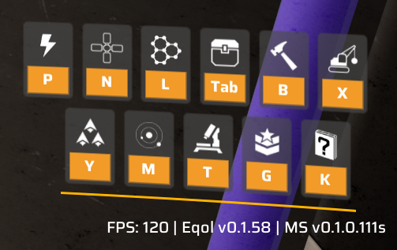

# Elvenide's HUD Stats

**Elvenide's HUD Stats** is a lightweight HUD enhancement for **Main Sequence** that displays live FPS and total save play time in the bottom-right corner alongside the game version, built with UE4SS Lua.

It is designed to feel native to the base game—matching its exact UI style—and is **100% save-safe and removable** without adding custom items, machines, or save dependencies.

## Getting Started

- **[Getting Started & Installation Guide](docs/get-started.md)**

## HUD FPS & Playtime Bar

Enhances *Main Sequence*'s existing bottom-right version label in-place to show your live FPS and total save play time alongside the *Main Sequence* version number.


*Bottom-right HUD showing live FPS and stats alongside the Main Sequence version.*

### Format

```text
FPS: <fps> | Playtime: <H:MM:SS> | MS v<main sequence version>
```

*(On the Main Menu before loading into a save, Playtime is automatically omitted: `FPS: <fps> | MS v<main sequence version>`.)*

### Details

- Edits the vanilla bottom-right version text in-place with live FPS and total save play time (automatically falling back to session play time if a save's total play time property is not exposed).
- Updates twice per second (`0.5s` interval) using Unreal's native frame delta with near-zero overhead.

## Credits

**Elvenide's HUD Stats** is created and maintained by Elvenide. This is an unofficial mod and I'm not affiliated with Main Sequence.

> If you have questions or run into issues, feel free to reach out in #modding-guides within the [official Main Sequence Discord server](https://discord.com/invite/uy8w2pTcQE).
